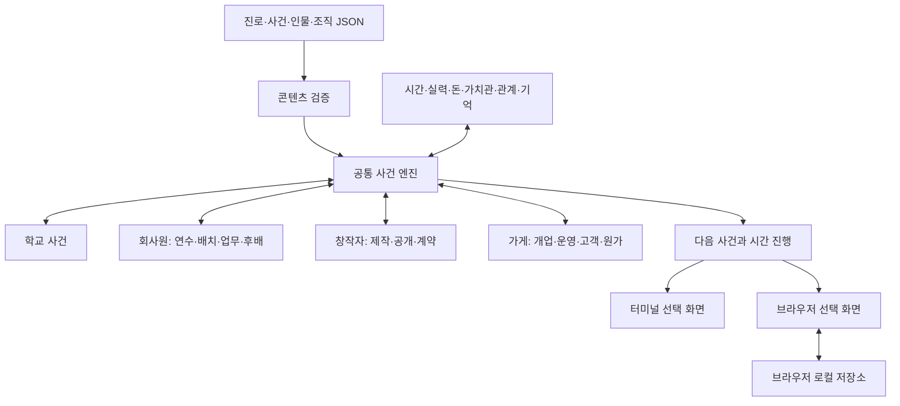

# 구조와 확장 방법

## 경계

게임의 상태, 이야기 데이터, 화면을 분리한다. 공통 엔진은 회사의 인사 체계나 월급을 전제로 삼지 않는다.



`src/core`는 파일이나 네트워크에 접근하지 않는다. 같은 상태와 선택을 전달하면 같은 결과를 반환하고, 입력 객체는 변경하지 않는다. `src/core/session.js`의 `nextScene()`은 사건이 없는 기간을 다음 사건까지 진행하는 공통 규칙이다.

Node에서는 `src/content`가 JSON을 읽고 `src/cli`가 입력·출력을 담당한다. 웹에서는 `web/app.js`가 같은 JSON을 가져와 공통 엔진에 전달하고, 상태를 화면과 브라우저 저장소에 연결한다. 화면별로 사건의 결과나 조건 판정을 다시 구현하지 않는다.

## 웹 실행과 저장

`npm start`는 웹 파일을 빌드한 뒤 `http://localhost:4173`에서 정적 서버를 실행한다. `npm run build`만 실행하면 `dist/`에 `index.html`, `app.js`, `styles.css`, `core/`와 `data/`가 만들어진다. 정적 호스팅에는 이 디렉터리 전체를 제공한다. 프레임워크나 외부 npm 패키지, 게임용 서버 API는 필요하지 않다.

브라우저 흐름은 `새 인생 → 학교 사건 → 생활 경로 선택 → 사건과 결과 → 회고`다. 선택 직후 엔진이 반영한 상태를 저장하고 결과를 보여준다. 새로고침 후 같은 선택이 다시 적용되거나 거래가 중복 발생하지 않도록, 결과 화면도 진행 상태와 함께 다룬다.

웹은 `localStorage`에 자동 저장하며 불러올 때 공통 엔진의 `restoreGame()`으로 상태를 검증한다. 저장할 수 없는 환경에서는 저장 실패를 안내하고 현재 페이지에서 플레이를 계속할 수 있게 한다. 브라우저 저장은 같은 출처(origin)에 한정되며 기기·브라우저·다른 사이트 주소와 동기화하지 않는다. 사이트 데이터를 지우면 저장도 사라진다.

터미널은 기존대로 `saves/slot-1.json`을 사용하고, `npm run cli -- --load`로 이어한다. 웹 저장과 터미널 파일 저장은 서로 독립적이다. 저장 버전 규칙은 두 화면에서 공유한다.

## 상태

| 필드 | 의미 |
|---|---|
| `schemaVersion`, `rngSeed` | 저장 형식 버전과 재현 가능한 인물 성향 변주 |
| `time` | 시작 후 지난 개월과 현재 나이(개월) |
| `player.stats` | 건강, 행복, 업무 스트레스, 대인 스트레스 |
| `player.skills` | 수학·언어·과학·예술·사업·소통의 예시 기초 능력 |
| `player.values` | 부, 영향력, 작업의 완성도, 안정, 자유를 중시하는 정도 |
| `player.money`, `ledger` | 공용 현금과 급여·매출·비용별 거래 내역 |
| `facts` | 친구를 도왔는지, 교육을 마쳤는지 등 조건에 쓰는 사실 |
| `people` | 실제로 만난 인물의 고정 성향, 현재 관계, 첫 만남 시점 |
| `memories`, `history` | 이야기로 남는 경험과 선택·경로 전환 이력 |
| `activeTrack`, `progress` | 현재 생활 경로와 경로별 단계·고유 지표·끝낸 사건 |

능력치와 가치관은 0~100, 인물 관계는 -100~100이다. `employee`의 성과·후배 교육, `creator`의 작품·관객, `owner`의 고객 신뢰·운영 경험은 각각 별도 `metrics`로 둔다. 연구자나 선수의 지표를 추가할 때 회사의 성과 점수로 번역할 필요가 없다.

관계는 현재 인물별 숫자 하나와 기억으로 표현한다. 신뢰·갈등의 분리, 인물끼리의 관계, 소속 변화·라인·자율 행동은 추가 설계가 필요하다. 현재 조직 JSON은 설명 자료이고 엔진이 조직 문화로 사건을 자동 생성하지 않는다.

## 진로와 생활 경로는 다른 데이터

`career-tree.json`은 `관심 → 분야 → 세부 분야 → 직업` 그래프다. `parentIds`를 여러 개 둘 수 있어 게임 제작에 공학이나 예술에서 진입할 수 있다. `trackId`는 해당 직업에서 쓸 생활 경로를 가리킨다. `planned`는 아직 실행할 수 없는 진로다.

현재 웹과 CLI에서는 세부 트리를 탐색하지 않고 학교 사건 이후 세 생활 경로를 직접 고른다. 학력·자격에 따른 지원 조건, 입학과 채용의 성공 판정은 구현하지 않았다. 이를 추가할 때 성적·비용·준비 경험을 조건으로 연결하고 재도전·다른 진입 경로도 함께 제공한다.

## 사건 처리

1. 현재 경로의 경과 월과 `atMonth`를 비교한다.
2. 이미 끝낸 사건과 `requires`를 만족하지 않는 사건을 제외한다.
3. 가장 먼저 도래한 사건을 화면에 제시한다. 선택지에도 별도 조건을 둘 수 있다.
4. 선택의 효과를 순서대로 처리한다. 인물을 만난 뒤 관계를 바꾸는 것처럼 순서가 중요하다.
5. 선택에 적힌 개월을 진행하고 선택·결과·완료 기록을 남긴다.

학교에서 친구를 도왔던 경험을 요구하는 선택지는 아래처럼 쓴다. 실제 데이터는 `data/events.json`의 `creator-production`을 참고한다.

```json
{
  "id": "collaborate-friend",
  "label": "학교 친구와 역할을 나누어 작품을 만든다",
  "requires": [
    { "path": "facts.helpedSchoolFriend", "op": "eq", "value": true }
  ],
  "durationMonths": 3,
  "effects": [
    { "type": "meet", "personId": "school-friend" },
    { "type": "add", "path": "people.school-friend.relationship", "value": 10 },
    { "type": "set", "path": "progress.creator.phase", "value": "release" },
    { "type": "remember", "text": "학교 친구와 첫 작품을 만들었다.", "tags": ["school", "creator"] }
  ],
  "outcome": "예전에 쌓은 신뢰가 새로운 협업으로 이어졌다."
}
```

조건 연산은 `eq`, `gte`, `lte`, `exists`, `includes`를 지원하며 배열 안의 조건은 모두 만족해야 한다. `exists: true`는 값이 `false`여도 필드가 있으면 성립한다. 참인지 검사하려면 `eq: true`를 쓴다. 임의의 JavaScript 코드를 이야기 데이터에서 실행하지 않는다.

| 효과 | 기능 |
|---|---|
| `add`, `set` | 허용된 능력치·관계·단계·사실·경로 지표 변경 |
| `meet` | 처음 만난 인물을 추가. 재회하면 성향과 관계 유지 |
| `remember` | 시점과 태그를 붙여 경험 저장 |
| `payment` | `salary`, `revenue`, `expense`와 금액·사유 기록 |

인물 성향은 예시 기준값에 seed로 정한 -10~10 변주를 한 번 적용한다. 이 분포는 현실 조사 결과가 아니다. 현재 사건 결과는 선택과 조건으로 정해지고, 성향이 모든 사건 결과를 자동 결정하지는 않는다.

## 시간과 경제의 현재 규칙

공통 단위는 개월이다. 사건이 없는 기간은 공통 `nextScene()`이 다음 사건까지 넘긴다. 직업마다 도래 시점과 선택에 걸리는 기간이 다르므로 회사의 평가 주기에 묶이지 않는다. 일·주 단위 정밀 일정은 향후 시간 표현과 저장 버전을 함께 확장한다.

`enterTrack()`으로 경로를 바꾸면 인물·돈·기억·이력은 보존된다. 비활성 경로의 로컬 시간은 멈추고 다시 돌아오면 이어한다. 이는 구조 예제의 재개 규칙이며 휴직·연구·가게 운영이 현실에서 자동으로 정지한다는 모델은 아니다. 정식 전직·휴업·복직에는 달력에 따른 계약·비용·동료 변화 처리가 필요하다. 현재 화면에는 직업 간 전환 메뉴가 없고 엔진 API와 테스트에서 확인한다.

금액은 KRW 정수이며 `payment`는 선택 시점에 한 번만 반영한다. 시작 자금 1천만 원도 검증용 상수다. 사업 매출은 거래 종류로 구분되지만 개인·사업 계좌와 세금은 아직 분리하지 않았다. 자동 급여·생활비·정기 결산·물가·부채·장기 손익은 없다.

## 확장할 때

1. **새 사건:** 현재 효과로 표현 가능하면 JSON에 조건·선택·결과를 추가하고 `npm run validate`, `npm test`로 연결을 확인한다.
2. **새 직업:** 경로별 지표와 생활 주기를 먼저 정의한다. 연구비·논문, 시즌·부상, 선거·임기를 승진으로 바꾸어 표현하지 않는다.
3. **새 행동 체계:** 생산·재고·세금·선거처럼 복잡한 계산은 별도 직업 모듈을 만들고, 공통 기록에 결과를 전달한다. 모든 규칙을 JSON의 숫자 변경으로 억지로 표현하지 않는다.
4. **현실 자료:** [조사 계획](research-plan.md)에 따라 관측 데이터와 출처를 추가하고, 예시값·추정·게임 보정값을 분리한다.
5. **저장 형식:** 필수 필드의 의미를 바꾸면 버전을 올리고 마이그레이션을 작성한다. 현재는 버전 1만 복원한다.

다음 구현의 우선순위는 세부 진로 선택 화면, 학교·채용 조건, 세 경로의 실제 생활 주기와 수입 계산이다. 이 구조만으로 평생의 모든 직업이 자동 생성되는 것은 아니다.
